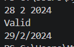
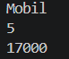

# <h1 align="center">Laporan Praktikum Modul 07 - Percabangan</h1>
<p align="center">Rafif  Ramadhan - 109092630001</p>

## Dasar Teori

### A. Konsep Percabangan
Percabangan (*branching* atau *selection*) adalah struktur kontrol yang memungkinkan program memilih instruksi yang akan dijalankan berdasarkan suatu kondisi. Kondisi tersebut dievaluasi menjadi nilai boolean, yaitu `true` (benar) atau `false` (salah). Dengan percabangan, program dapat memberikan respons yang berbeda terhadap nilai masukan atau keadaan tertentu.

Contohnya, program dapat menentukan apakah nilai memenuhi batas kelulusan, mengelompokkan bilangan sebagai positif atau negatif, maupun memilih tindakan berdasarkan opsi menu.

### B. Operator Kondisi
Kondisi percabangan umumnya dibentuk menggunakan operator perbandingan dan operator logika.

| Jenis operator | Operator | Keterangan |
|---|---|---|
| Perbandingan | `==`, `!=`, `<`, `<=`, `>`, `>=` | Membandingkan dua nilai dan menghasilkan `true` atau `false`. |
| Logika | `&&` | Menghasilkan `true` jika kedua kondisi bernilai `true`. |
| Logika | `||` | Menghasilkan `true` jika setidaknya satu kondisi bernilai `true`. |
| Logika | `!` | Membalik nilai boolean, dari `true` menjadi `false` atau sebaliknya. |

Sebagai contoh, kondisi `nilai >= 75 && kehadiran >= 80` bernilai benar hanya jika nilai minimal 75 dan kehadiran minimal 80.

### C. Percabangan `if`, `if-else`, dan `else if`
Pernyataan `if` menjalankan blok kode hanya ketika kondisinya bernilai `true`:
```go
if nilai >= 75 {
    fmt.Println("Lulus")
}
```

Pernyataan `if-else` memilih salah satu dari dua jalur. Blok `else` dijalankan ketika kondisi `if` bernilai `false`:
```go
if nilai >= 75 {
    fmt.Println("Lulus")
} else {
    fmt.Println("Tidak lulus")
}
```

Rangkaian `else if` digunakan untuk memeriksa beberapa kondisi secara berurutan. Program menjalankan blok pertama yang kondisinya benar, kemudian melewati kondisi-kondisi berikutnya:
```go
if nilai >= 85 {
    fmt.Println("A")
} else if nilai >= 70 {
    fmt.Println("B")
} else if nilai >= 60 {
    fmt.Println("C")
} else {
    fmt.Println("D")
}
```

Urutan kondisi perlu diperhatikan. Kondisi yang lebih spesifik atau memiliki batas lebih tinggi sebaiknya diperiksa lebih dahulu agar tidak tertangkap oleh kondisi sebelumnya. Setiap kondisi pada rangkaian tersebut dievaluasi dari atas ke bawah.

### D. Percabangan Bersarang (*Nested If*)
Percabangan bersarang adalah pernyataan percabangan yang ditempatkan di dalam blok percabangan lain. Bentuk ini dapat digunakan ketika pemeriksaan kedua hanya diperlukan setelah kondisi pertama terpenuhi:
```go
if umur >= 17 {
    if memilikiKTP {
        fmt.Println("Dapat membuat SIM")
    } else {
        fmt.Println("KTP diperlukan")
    }
} else {
    fmt.Println("Belum cukup umur")
}
```

Percabangan bersarang sebaiknya digunakan ketika memang ada ketergantungan antar-kondisi. Untuk kondisi yang sejajar, rangkaian `else if` biasanya lebih mudah dibaca.

### E. Percabangan `switch`
Pernyataan `switch` memilih satu blok dari beberapa kemungkinan nilai. Struktur ini berguna untuk menangani pilihan yang jelas, seperti nomor menu atau nama hari:
```go
switch pilihan {
case 1:
    fmt.Println("Lihat saldo")
case 2:
    fmt.Println("Tarik uang")
case 3:
    fmt.Println("Keluar")
default:
    fmt.Println("Pilihan tidak valid")
}
```
Pada Go, hanya `case` yang cocok yang dijalankan secara default; eksekusi tidak berlanjut otomatis ke `case` berikutnya. Bagian `default` bersifat opsional dan dijalankan apabila tidak ada `case` yang cocok. Go juga mendukung `switch` tanpa ekspresi, yang dapat digunakan untuk menguji kondisi boolean:
```go
switch {
case nilai >= 85:
    fmt.Println("A")
case nilai >= 70:
    fmt.Println("B")
default:
    fmt.Println("C")
}
```

### F. Sintaks dan Hal yang Perlu Diperhatikan di Go
Kondisi pada `if` dan `switch` tidak ditulis di dalam tanda kurung. Kurung kurawal `{}` wajib digunakan untuk menandai blok kode, termasuk ketika blok hanya berisi satu instruksi. Kata kunci `else` harus berada pada baris yang sama dengan kurung kurawal penutup blok `if`:
```go
if kondisi {
    // instruksi ketika kondisi benar
} else {
    // instruksi ketika kondisi salah
}
```

Percabangan menentukan jalur instruksi yang dijalankan, sedangkan perulangan menjalankan instruksi berulang kali. Keduanya dapat digabungkan, misalnya dengan menggunakan `if` untuk memvalidasi transaksi di dalam perulangan menu.

---

## Guided

### 1. kabisat.go

```go
package main

import "fmt"

func main() {
	var tahun int
	fmt.Scan(&tahun)

	if (tahun%4 == 0 && tahun%100 != 0) || (tahun%400 == 0) {
		fmt.Println("Ya")
	} else {
		fmt.Println("Tidak")
	}
}


```

#### Deskripsi
Program `kabisat.go` menentukan apakah tahun yang dimasukkan merupakan tahun kabisat. Tahun kabisat adalah tahun yang habis dibagi 400, atau habis dibagi 4 tetapi tidak habis dibagi 100.

Cara kerja program:
1. Program membaca masukan tahun ke variabel `tahun`.
2. Kondisi `if` memeriksa aturan tahun kabisat menggunakan operator sisa bagi (`%`) dan operator logika.
3. Jika tahun memenuhi aturan tersebut, program mencetak `Ya`; jika tidak, program mencetak `Tidak`.

---

### 2. segitiga.go

```go
package main

import "fmt"

func main() {
	var a, b, c int
	fmt.Scan(&a, &b, &c)

	if a <= 0 || b <= 0 || c <= 0 || a+b <= c || a+c <= b || b+c <= a {
		fmt.Println("bukan segitiga")
	} else if a == b && b == c {
		fmt.Println("segitiga sama sisi")
	} else if a == b || a == c || b == c {
		fmt.Println("segitiga sama kaki")
	} else {
		fmt.Println("segitiga sembarang")
	}
}
```

#### Deskripsi
Program `segitiga.go` memeriksa apakah tiga panjang sisi dapat membentuk segitiga, lalu menentukan jenis segitiganya.

Cara kerja program:
1. Program membaca tiga panjang sisi, yaitu `a`, `b`, dan `c`.
2. Percabangan pertama menolak sisi yang tidak positif atau yang tidak memenuhi syarat ketaksamaan segitiga, lalu mencetak `bukan segitiga`.
3. Jika sisi-sisinya valid, program memeriksa apakah ketiganya sama panjang untuk mengidentifikasi segitiga sama sisi.
4. Jika dua sisi sama panjang, program mencetak segitiga sama kaki. Selain itu, program mencetak segitiga sembarang.

---

### 3.kalkulator.go

```go
package main

import "fmt"

func main() {
	var a, b int
	var op string

	fmt.Scan(&a, &op, &b)

	switch op {
	case "+":
		fmt.Println(a + b)
	case "-":
		fmt.Println(a - b)
	case "*":
		fmt.Println(a * b)
	case "/":
		if b == 0 {
			fmt.Println("Error: pembagian dengan nol")
		} else {
			fmt.Printf("%.2f\n", float64(a)/float64(b))
		}
	case "%":
		if b == 0 {
			fmt.Println("Error: pembagian dengan nol")
		} else {
			fmt.Println(a % b)
		}
	default:
		fmt.Println("Operator tidak valid")
	}
}
```

#### Deskripsi
Program `kalkulator.go` menerima dua bilangan bulat dan sebuah operator, kemudian menghitung hasil operasi yang dipilih.

Cara kerja program:
1. Program membaca bilangan pertama (`a`), operator (`op`), dan bilangan kedua (`b`).
2. Pernyataan `switch` memilih operasi penjumlahan, pengurangan, perkalian, pembagian, atau modulus.
3. Pembagian menghasilkan bilangan desimal dengan dua angka di belakang koma. Sebelum pembagian atau modulus, program memeriksa apakah `b` bernilai nol dan mencetak pesan kesalahan jika demikian.

---
### 4. ongkir.go
```go
package main

import (
	"fmt"
	"math"
)

func main() {
	var berat float64
	var zona int
	var layanan string

	fmt.Scan(&berat, &zona, &layanan)

	if berat > 30 {
		fmt.Println("Berat melebihi batas maksimum (30 kg)")
		return
	}

	var tarifPerkg int

	switch zona {
	case 1:
		tarifPerkg = 10000
	case 2:
		tarifPerkg = 15000
	case 3:
		tarifPerkg = 25000
	default:
		fmt.Println("Zona tidak valid")
		return
	}

	beratBulat := int(math.Ceil(berat))
	total := beratBulat * tarifPerkg

	if layanan == "Express" {
		total += total / 2
	}

	fmt.Println(beratBulat)
	fmt.Println(total)
}
```

#### Deskripsi
Program `ongkir.go` menghitung biaya pengiriman berdasarkan berat paket, zona tujuan, dan layanan yang dimasukkan.

Cara kerja program:
1. Program membaca berat paket (`berat`), nomor zona (`zona`), dan jenis layanan (`layanan`).
2. Jika berat melebihi 30 kg, program mencetak pesan bahwa berat melewati batas dan berhenti.
3. Pernyataan `switch` menentukan tarif per kilogram: Rp10.000 untuk zona 1, Rp15.000 untuk zona 2, dan Rp25.000 untuk zona 3. Nomor zona lain menghasilkan pesan kesalahan dan menghentikan program.
4. Berat dibulatkan ke atas menggunakan `math.Ceil`, kemudian dikalikan dengan tarif zona untuk memperoleh biaya dasar.
5. Jika nilai layanan yang dimasukkan tepat `Express`, program menambahkan 50% dari total biaya dasar.
6. Program mencetak berat yang telah dibulatkan dan total biaya.

## Unguided

### 1. besok.go


```go
package main

import "fmt"

func main() {
	var d, m, y int
	fmt.Scan(&d, &m, &y)

	if m < 1 || m > 12 || y <= 0 {
		fmt.Println("Tidak valid")
		return
	}

	var maxDays int
	switch m {
	case 1, 3, 5, 7, 8, 10, 12:
		maxDays = 31
	case 4, 6, 9, 11:
		maxDays = 30
	case 2:
		isKabisat := (y%4 == 0 && y%100 != 0) || (y%400 == 0)
		if isKabisat {
			maxDays = 29
		} else {
			maxDays = 28
		}
	}

	if d < 1 || d > maxDays {
		fmt.Println("Tidak valid")
		return
	}

	nextD := d + 1
	nextM := m
	nextY := y

	if nextD > maxDays {
		nextD = 1
		nextM++
		if nextM > 12 {
			nextM = 1
			nextY++
		}
	}

	fmt.Println("Valid")
	fmt.Printf("%d/%d/%d\n", nextD, nextM, nextY)
}
```

##### Output



#### Deskripsi
Program `besok.go` memeriksa validitas tanggal yang dimasukkan, lalu menampilkan tanggal satu hari setelahnya jika tanggal tersebut valid.

Cara kerja program:
1. Program membaca tanggal, bulan, dan tahun ke variabel `d`, `m`, dan `y`.
2. Program memeriksa apakah bulan berada pada rentang 1–12 dan tahun lebih besar dari 0. Jika tidak, program mencetak `Tidak valid` lalu berhenti.
3. Pernyataan `switch` menentukan jumlah hari maksimum pada bulan tersebut. Untuk Februari, program memeriksa tahun kabisat dengan aturan: habis dibagi 400, atau habis dibagi 4 tetapi tidak habis dibagi 100.
4. Program memeriksa apakah tanggal berada pada rentang yang sesuai dengan bulan. Jika tidak, program mencetak `Tidak valid` lalu berhenti.
5. Jika tanggal valid, program menambahkan satu hari. Ketika tanggal melewati hari terakhir bulan, tanggal diatur menjadi 1 dan bulan bertambah. Jika bulan melewati Desember, bulan diatur menjadi 1 dan tahun bertambah.
6. Program mencetak `Valid` dan tanggal berikutnya dengan format `hari/bulan/tahun`.

### 2. parkir.go

```go
package main

import "fmt"

func main() {
	var jenis string
	var jam int
	fmt.Scan(&jenis, &jam)

	var total int
	if jenis == "Mobil" {
		if jam <= 1 {
			total = 5000
		} else {
			total = 5000 + (jam-1)*3000
		}
		if jam > 24 {
			total += 50000
		}
	} else if jenis == "Motor" {
		if jam <= 1 {
			total = 3000
		} else {
			total = 3000 + (jam-1)*2000
		}
		if jam > 24 {
			total += 30000
		}
	}

	fmt.Println(total)
}
```

#### Deskripsi
Program `parkir.go` menghitung biaya parkir berdasarkan jenis kendaraan dan lama parkir dalam jam.

Cara kerja program:
1. Program membaca jenis kendaraan (`jenis`) dan lama parkir (`jam`).
2. Untuk mobil, tarif jam pertama adalah Rp5.000 dan setiap jam berikutnya dikenai Rp3.000. Untuk motor, tarif jam pertama adalah Rp3.000 dan setiap jam berikutnya dikenai Rp2.000.
3. Jika lama parkir lebih dari 24 jam, program menambahkan biaya tambahan Rp50.000 untuk mobil atau Rp30.000 untuk motor.
4. Program mencetak total biaya parkir yang dihitung.

##### Output


## Kesimpulan
Dari praktikum Modul 07 mengenai percabangan dalam bahasa pemrograman Go, dapat disimpulkan bahwa:
1. Percabangan `if`, `else if`, dan `else` memungkinkan program menguji kondisi secara berurutan, seperti menentukan tahun kabisat, memvalidasi sisi segitiga, dan menetapkan biaya pengiriman atau parkir.
2. Operator perbandingan dan logika dapat digabungkan untuk memeriksa beberapa syarat sekaligus, misalnya aturan tahun kabisat dan syarat panjang sisi segitiga.
3. Pernyataan `switch` memudahkan pemilihan tindakan berdasarkan nilai tertentu, seperti operator pada kalkulator dan zona tujuan pengiriman.
4. Percabangan membantu program menangani masukan yang tidak valid secara tepat, seperti tanggal yang tidak sesuai kalender, berat paket yang melewati batas, zona yang tidak tersedia, atau pembagian dengan nol.
5. Latihan-latihan ini menunjukkan bahwa struktur percabangan dapat diterapkan pada berbagai masalah praktis dengan aturan dan keluaran yang berbeda.